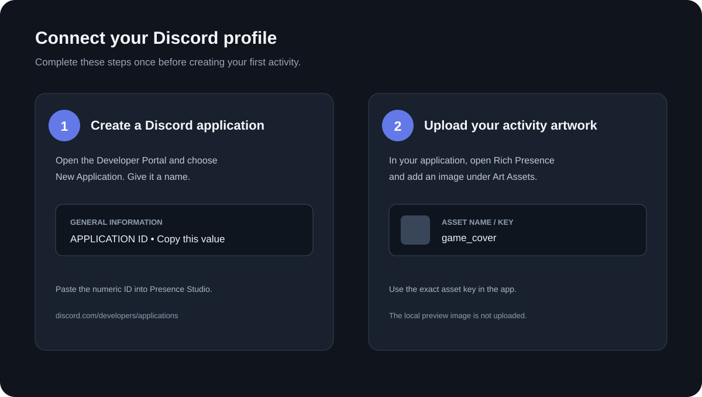
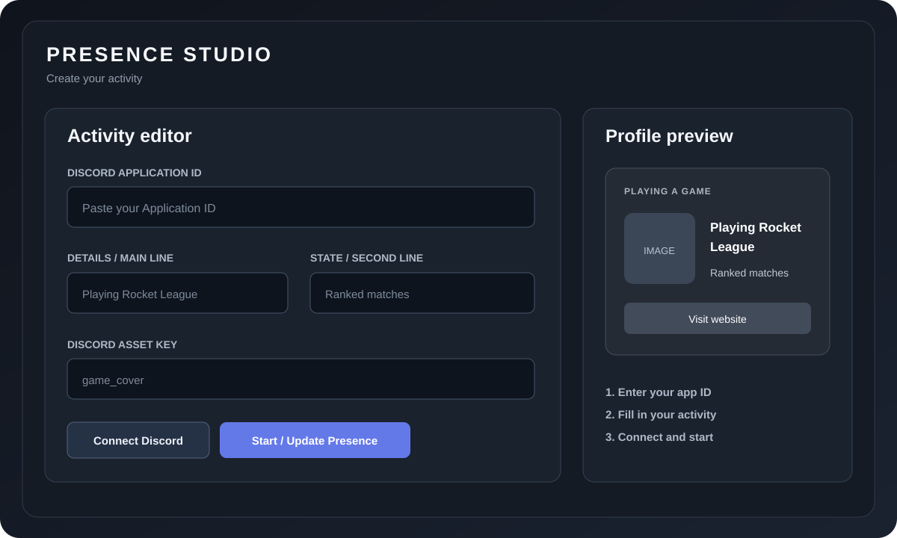

# Presence Studio

A Windows desktop app for creating a Discord Rich Presence activity and previewing its layout before publishing it to your profile.

## Download and install

1. Open the [latest release](https://github.com/s7lrr/real-actvity/releases).
2. Under **Assets**, download `PresenceStudio-Setup.exe`.
3. Double-click the installer and follow the steps.
4. Launch **Presence Studio** from the Desktop shortcut or Start Menu.

You do not need to install Python or any programming libraries when using the setup installer.

## First-time Discord setup

### 1. Create your Discord application

1. Open the [Discord Developer Portal](https://discord.com/developers/applications).
2. Select **New Application** and give it a name.
3. Open **General Information** and copy the **Application ID**.
4. Paste that number into the Application ID field in Presence Studio.

### 2. Upload your activity image

1. Open your application in the Developer Portal.
2. Go to **Rich Presence** and then **Art Assets**.
3. Upload the image you want Discord to display.
4. Copy the asset's exact key/name.
5. Paste that key into **Discord Asset Key** in Presence Studio.

The **Choose preview image** button only displays a local preview inside Presence Studio. It does not upload the image to Discord. Discord displays the image uploaded to your application's Art Assets.

### 3. Create and publish your activity

1. Open the Discord **Desktop** application and sign in.
2. Keep Discord running in the background.
3. Open Presence Studio.
4. Paste your Application ID.
5. Enter your main activity line in **Details / Main Line**.
6. Enter the second line in **State / Second Line**.
7. Add your Discord asset key if you want an image.
8. Optionally add a button label and a valid `https://` URL.
9. Click **Connect Discord**.
10. Click **Start / Update Presence**.
11. Open your Discord profile to view the activity. Keep Presence Studio running while you want the activity to remain active.

## What the fields mean

| Field | Purpose |
|---|---|
| Application ID | Identifies your Discord Developer Portal application. |
| Details / Main Line | The primary line shown in your activity. |
| State / Second Line | The secondary line shown below the primary line. |
| Discord Asset Key | The exact name of an image uploaded under your application's Art Assets. |
| Choose preview image | Shows a local-only preview in this app; it is not sent to Discord. |
| Button Label and URL | Optional activity button. Both fields must be filled in to show it. |

## Saved presets

Use **Save current preset** to save your current activity settings on this computer. Select a saved preset to load it again. Presets and the last-used settings are stored locally in `%APPDATA%\PresenceStudio\settings.json`.

## Troubleshooting

- **Discord not found:** Open the Discord Desktop app, then click **Connect Discord** again. The browser version is not sufficient for the local RPC connection.
- **Image not visible:** Confirm that the image was uploaded under Rich Presence → Art Assets and that the asset key matches exactly.
- **Activity not visible on your profile:** Check Discord activity privacy settings and make sure Presence Studio remains open.
- **Button not visible:** Enter both a button label and a valid `https://` or `http://` URL.

## Important limitations

- This application uses Discord's local desktop RPC connection. It does not set custom Rich Presence from the Discord mobile app.
- It does not request your Discord password, account token, or browser cookies.
- It cannot force Discord's separate Go Live / Streaming card to appear. It publishes a Rich Presence activity.

## Build from source

For developers who want to build the application themselves:

1. Install Python 3.10 or newer on Windows.
2. Open this project folder in File Explorer.
3. Double-click `build.bat`.
4. The executable will be created at `dist\PresenceStudio.exe`.

To create the Windows installer manually, install Inno Setup and compile `installer\PresenceStudio.iss` after building the executable.

## Support

Report bugs or request improvements through the repository's [Issues](https://github.com/s7lrr/real-actvity/issues) page.
