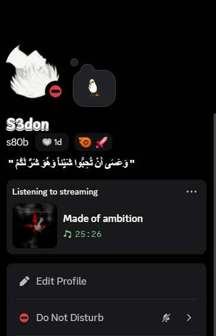
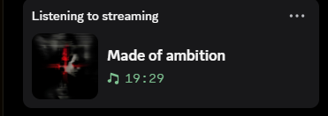

# Presence Studio

A simple desktop application for managing your Discord Rich Presence.

## Download

[Download Presence Studio](https://github.com/s7lrr/real-actvity/releases/tag/discord)

## Installation

1. Open the download link above.
2. Scroll down to the **Assets** section.
3. Download `PresenceStudio-Setup.exe`.
4. Run the installer.
5. Follow the installation steps.
6. Open Presence Studio.

## How to Use

1. Launch Presence Studio.
2. Enter your Discord Application ID.
3. Customize your activity details.
4. Add your images and configure your presence.
5. Click **Start Presence**.
6. Keep the application running while using Discord.

## Requirements

- Windows 10 or Windows 11.
- Discord Desktop.
- Internet connection.

## Screenshots

### Example 1

### Example 2

## Support

For issues or suggestions, open an issue in this repository.
